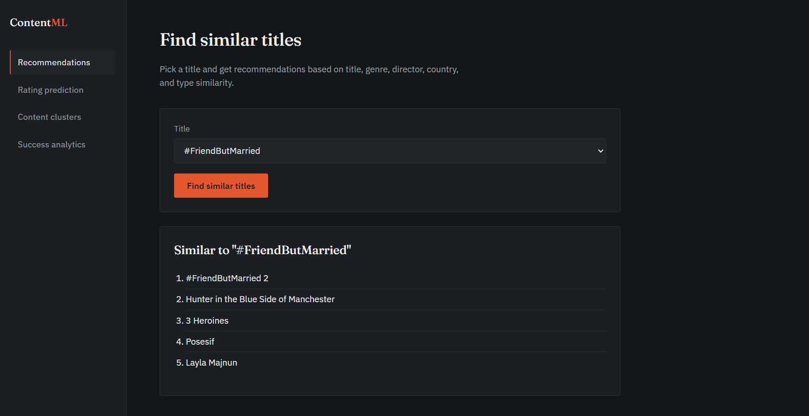
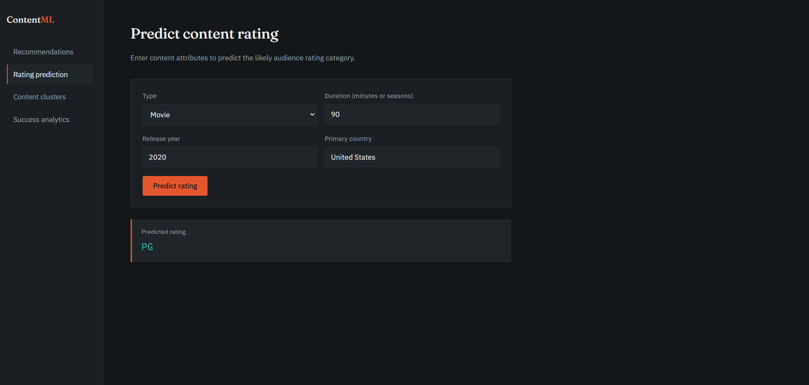
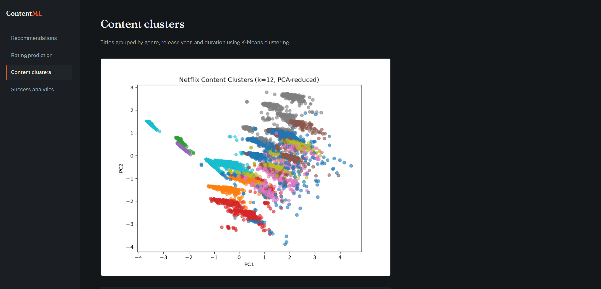
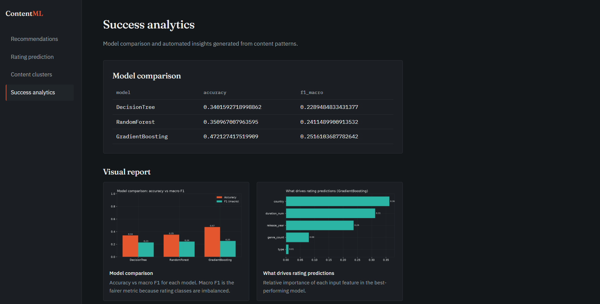

# Netflix Content ML Suite

A machine learning web application that analyzes Netflix catalogue metadata to deliver content recommendations, audience rating prediction, content segmentation, and automated analytics with a visual report. The project pairs a modular Python codebase with a Flask interface, and a single command builds all required models and charts and starts the application.

## Table of Contents

- [Features](#features)
- [Screenshots](#screenshots)
- [Architecture](#architecture)
- [Tech Stack](#tech-stack)
- [Project Structure](#project-structure)
- [Dataset](#dataset)
- [Getting Started](#getting-started)
  - [Prerequisites](#prerequisites)
  - [Installation](#installation)
- [Usage](#usage)
- [Results](#results)
- [Limitations](#limitations)
- [Future Improvements](#future-improvements)
- [Contact](#contact)

## Features

| Module | ML Problem | Approach | Output |
|:---|:---|:---|:---|
| **Recommendations** | Similarity retrieval | TF-IDF vectorization and cosine similarity over title, genre, director, country, and type | Top five similar titles for a selected title |
| **Rating Prediction** | Multi-class classification | Decision Tree, Random Forest, Logistic Regression with GridSearchCV; evaluated on macro F1 | Predicted audience rating and model comparison |
| **Content Segmentation** | Unsupervised clustering | K-Means with k selected by silhouette score (k = 2 to 12); PCA for visualization | Cluster assignments, 2D plot, cluster profiles |
| **Success Analytics** | Model comparison and reporting | Decision Tree, Random Forest, Gradient Boosting on an extended feature set | Performance comparison, generated insights, and a six-chart visual report |

Additional capabilities:

- Single-command startup: missing artifacts and charts are built automatically; existing ones are reused.
- Fault isolation: a failure in one module (or one chart) is logged and does not prevent the application from starting.
- Separate training and inference paths, with saved encoders reused at prediction time to avoid training-serving skew.
- Responsive layout that adapts from desktop to mobile widths.

## Screenshots

| Recommendations | Rating prediction |
|:---|:---|
|  |  |

| Content clusters | Success analytics |
|:---|:---|
|  |  |

[Browse all screenshots](screenshots/)

## Architecture

```
python app.py
   |
   |-- ensure_artifacts()
   |      |-- Data ingestion  -> raw / train / test CSV files
   |      |-- Recommendations -> similarity matrix, title index
   |      |-- Rating model    -> best classifier, encoders
   |      |-- Segmentation    -> K-Means model, cluster plot, assignments
   |      |-- Analytics       -> model comparison, insights, six charts
   |
   |-- Flask server -> pages read saved artifacts; rating predictions run live
```

The codebase separates reusable **components** (ingestion, transformation, training, monitoring), **pipelines** (training and prediction), and **tasks** (one module per feature). Cross-cutting concerns such as logging, custom exceptions, and shared helpers are isolated in their own modules.

## Tech Stack

- **Language:** Python
- **Data and ML:** pandas, NumPy, scikit-learn
- **Visualization:** matplotlib, seaborn
- **Web:** Flask, Jinja2 (HTML templating), HTML, CSS
- **Tooling:** joblib (model persistence), Git

## Project Structure

```
Netflix_ML_Project/
├── app.py                      # Entry point: builds artifacts, starts Flask
├── templates/                  # Jinja2 HTML templates
├── static/
│   ├── style.css               # Stylesheet
│   └── task6/                  # Generated analytics charts (created on first run)
├── src/NetflixMLProject/
│   ├── components/             # data_ingestion, data_transformation, model_trainer, model_monitoring
│   ├── pipelines/              # training_pipeline, prediction_pipeline
│   ├── tasks/                  # task1, task3, task4, task6
│   ├── logger.py
│   ├── exception.py
│   └── utils.py
├── artifacts/                  # Generated data splits, models, plots, metrics
├── notebook/
│   ├── EDA_NETFLIX.ipynb       # Exploratory data analysis
│   └── data/Dataset.csv        # Source dataset
├── screenshots/                # Images used in this README
├── setup.py
├── requirements.txt
└── README.md
```

## Dataset

Netflix titles metadata with the following columns:

`show_id, type, title, director, country, date_added, release_year, rating, duration, listed_in`

The dataset does not include plot descriptions or cast information, so text features are derived from title, genre, director, country, and type. Exploratory analysis (`notebook/EDA_NETFLIX.ipynb`) informed the data cleaning decisions: handling of missing values, grouping of rare rating classes, parsing of the `duration` field, and splitting of multi-genre entries.

## Getting Started

### Prerequisites

- [Python](https://www.python.org/downloads/) 3.9 or higher
- [Git](https://git-scm.com/)

### Installation

1. **Get the code.** Clone this repository (use the green **Code** button on GitHub to copy its URL) or download it as a ZIP, then open a terminal in the project folder.

2. **Create and activate a virtual environment**
   ```bash
   python -m venv venv
   venv\Scripts\activate          # Windows
   # source venv/bin/activate     # macOS / Linux
   ```
   Conda users can instead run `conda create -n netflix-ml python=3.10` followed by `conda activate netflix-ml`.

3. **Install dependencies**
   ```bash
   pip install -r requirements.txt
   ```

4. **Start the application**
   ```bash
   python app.py
   ```
   Open http://127.0.0.1:5000 in a browser.

The source dataset is included in the repository at `notebook/data/Dataset.csv`; no separate download is required.

> The first run trains all models and generates the charts, which may take several minutes. Subsequent runs reuse the files in `artifacts/` and `static/task6/`. To rebuild a single module, delete its files and restart; to rebuild everything, delete the `artifacts/` and `static/task6/` directories.

## Usage

Navigate between modules using the sidebar.

- **Recommendations:** select a title and choose *Find similar titles*. The selected title is excluded from its own results.
- **Rating prediction:** complete the form and choose *Predict rating*. Example input:

  | Field | Example |
  |:---|:---|
  | Type | Movie |
  | Duration | 95 (minutes for movies, seasons for TV shows) |
  | Release year | 2019 |
  | Country | United States |

- **Content clusters:** review the cluster visualization and the assignment table.
- **Success analytics:** review the model comparison table, the generated insights, and the visual report (model comparison, feature importance, content split, titles added per year, top countries, and genre mix over time).

If a page reports that a model or chart was not found, the corresponding build failed during startup. Consult the `logs/` directory for details.

## Results

### Rating prediction (Task 3)

Models were tuned with GridSearchCV (scored on macro F1) and evaluated on a stratified 20% test split of 1,758 titles across 12 rating classes.

| Model | Accuracy | F1 (macro) |
|:---|:---|:---|
| Decision Tree | 0.291 | 0.184 |
| **Random Forest (best)** | **0.303** | **0.226** |
| Logistic Regression (with feature scaling) | 0.151 | 0.109 |

The best model is a Random Forest. The most common rating accounts for about 36% of the test set, so class-weighted models score below a majority-class guess on accuracy while performing better on rare classes; macro F1 is the fairer metric here.

### Content segmentation (Task 4)

K-Means with k = 12 (silhouette score 0.518). The 2D PCA view captures 35.7% of the variance. Cluster profiles:

| Cluster | Titles | Top genre | Top country | Avg release year |
|:---|:---|:---|:---|:---|
| 0 | 260 | Dramas | United States | 1978 |
| 1 | 1,062 | Dramas | India | 2015 |
| 2 | 834 | Documentaries | United States | 2017 |
| 3 | 248 | TV Dramas | United States | 2017 |
| 4 | 618 | Children & Family Movies | United States | 2014 |
| 5 | 833 | International TV Shows | Japan | 2017 |
| 6 | 575 | Romantic Movies | United States | 2013 |
| 7 | 741 | Action & Adventure | United States | 2012 |
| 8 | 713 | Independent Movies | United States | 2015 |
| 9 | 741 | Comedies | India | 2014 |
| 10 | 514 | International TV Shows | Pakistan | 2017 |
| 11 | 1,651 | Kids' TV | United States | 2016 |

Clusters separate mainly by genre family, region, and era, for example older US dramas (average release year 1978), a large Kids' TV group, and two International TV Shows groups led by Japan and Pakistan.

### Success analytics (Task 6)

An extended feature set (adds genre count) with default hyperparameters:

| Model | Accuracy | F1 (macro) |
|:---|:---|:---|
| Decision Tree | 0.340 | 0.229 |
| Random Forest | 0.351 | 0.241 |
| Gradient Boosting | 0.472 | 0.252 |

Task 6 does not use hyperparameter tuning and uses a different feature set, so its Random Forest figures differ from the tuned Task 3 model above. Differences between the three models are small and come from a single train/test split, so they should not be read as a definitive ranking.

Catalogue insights generated by the module:

- Content split is about 69.7% Movies and 30.3% TV Shows.
- The United States (3,240 titles), India (1,057), and the United Kingdom (638) contribute the most titles.
- The largest increases in title count between older and recent releases are International TV Shows (431), TV Dramas (296), and Crime TV Shows (249).

## Limitations

- **Limited predictive signal.** Type, duration, release year, and country carry little information about audience rating, which is reflected in a best macro F1 of 0.226 for the tuned model and about 0.25 across Task 6 models.
- **Weak linear baseline.** Logistic Regression is the weakest model (macro F1 0.109) because label-encoded categorical features do not suit a linear model; tree-based models handle them better.
- **Recommendation scope.** Without plot descriptions or cast, recommendations rely on title, genre, director, country, and type. Titles with identical metadata receive identical scores, and including the title text can favor titles that merely share a common word. No user interaction data is available, so quality was assessed qualitatively rather than with quantitative metrics.
- **Segmentation.** Silhouette increased at every k from 2 (0.214) to 12 (0.518), so k = 12 sits at the edge of the search range rather than at a clear optimum, and the score likely benefits from many near-duplicate points in binary and discrete features. The 2D PCA view shows only 35.7% of the variance, so overlap in the plot is partly a display limit, and `duration` combines minutes and seasons. Clusters are best read through their profiles.
- **Analytics.** "Success" cannot be measured directly because the dataset has no viewership or revenue data, so the module compares rating-prediction models and reports catalogue patterns instead. The most recent year in the titles-per-year chart may be incomplete, and the genre insight reports changes in title counts, not growth rates.
- **Feature encoding.** Country is label-encoded using the first listed country only.
- **Preprocessing order.** Encoders are fitted on the full dataset before the train/test split, introducing minor leakage. A scikit-learn Pipeline would resolve this.

## Future Improvements

- Incorporate plot descriptions and cast, and evaluate sentence embeddings for recommendations.
- Separate duration into minutes (movies) and seasons (TV shows) for cleaner clustering and classification features.
- Apply multi-label encoding for genres and one-hot or target encoding for country.
- Group ratings into audience tiers (Kids, Teen, Adult).
- Compare models using cross-validation with confidence intervals.
- Add automated tests, continuous integration, and containerized deployment with a production WSGI server.

## Contact

**Avni Gupta**
Email: [guptaavni535@gmail.com](mailto:guptaavni535@gmail.com)
LinkedIn: [linkedin.com/in/avni-gupta10](https://www.linkedin.com/in/avni-gupta10/)
GitHub: [github.com/AvniGupta09](https://github.com/AvniGupta09)